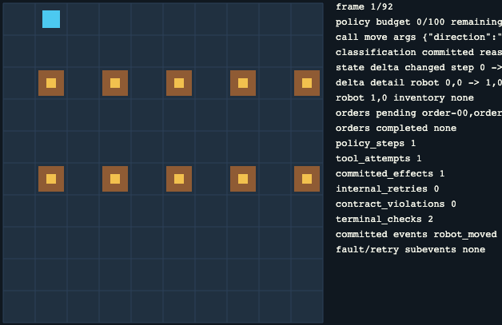

# Alejandro Bosch Cervera · AI & Data Engineer

I build LLM applications and agents, and the data platform underneath them: GCP pipelines in
BigQuery and dbt, Python services on Cloud Run, and agent systems I can evaluate and
reproduce instead of only demonstrating.

## Start here

One completed run, replayed offline from its own recorded evidence — no provider calls.

| Repository | What it shows |
|---|---|
| **[robot-factory-arena](https://github.com/Alejbc27/robot-factory-arena)** | Deterministic agent-evaluation harness: authorized tools, idempotency ledger, hard step and cost budgets, fault injection, hash-chained traces and offline replay. Reproducible from a seed. |
| **[TFM-Deusens](https://github.com/Alejbc27/TFM-Deusens)** | Conversational hotel assistant over RAG: document ingestion, vector search, Redis and PostgreSQL, split across microservices. |
| **[pintops](https://github.com/Alejbc27/pintops)** | Data engineering case study: public API ingestion, raw BigQuery load, idempotent SQL, Terraform and CI. |

## What I build

| Area | In practice |
|---|---|
| **Agents & LLM applications** | Multi-agent systems with Google ADK and Gemini: specialised agents, dynamic orchestration, parallel execution, tool calling, structured-output validation and guardrails. |
| **RAG** | Document ingestion and vector search integrated into a real conversational product, with OpenAI embeddings, chunking, asynchronous processing and per-client partitions. |
| **Data platform** | BigQuery and dbt models, event-driven pipelines on Cloud Run and Pub/Sub, data quality checks and cost control. |
| **Cloud & delivery** | Serverless GCP, Terraform, Docker, CI/CD with GitHub Actions, and Python services on Cloud Run. |

## Stack

**AI & agents** — Python · Google ADK · Gemini · LangChain · LangGraph · RAG · embeddings ·
vector search · agent evaluation · tool calling · structured outputs

**Data & cloud** — GCP (Cloud Run, Pub/Sub, BigQuery, Dataflow, Firestore, Secret Manager,
Cloud Scheduler) · dbt · SQL · PySpark · Apache Airflow (dbt orchestration) · PostgreSQL ·
Redis · Terraform · Docker · GitHub Actions

**Certifications** — Google Cloud Digital Leader · AWS Certified Cloud Practitioner ·
Microsoft Azure Data Fundamentals (DP-900)

**Languages** — Spanish (native) · Catalan/Valencian (native) · English (C1)

## How I work

Every claim in my repositories comes with its evidence. `robot-factory-arena` separates what is
verified from what is assumed, and states plainly what the system does *not* claim: no
exactly-once guarantee, no hostile-code sandbox, no scientific result.

I would rather ship a small system I can explain end to end than a large one I cannot.

## Contact

[LinkedIn](https://www.linkedin.com/in/alejandroboschcervera/) · Based in Valencia, Spain.
Open to Data Engineering and Applied AI / LLM Engineering roles, remote or hybrid.
